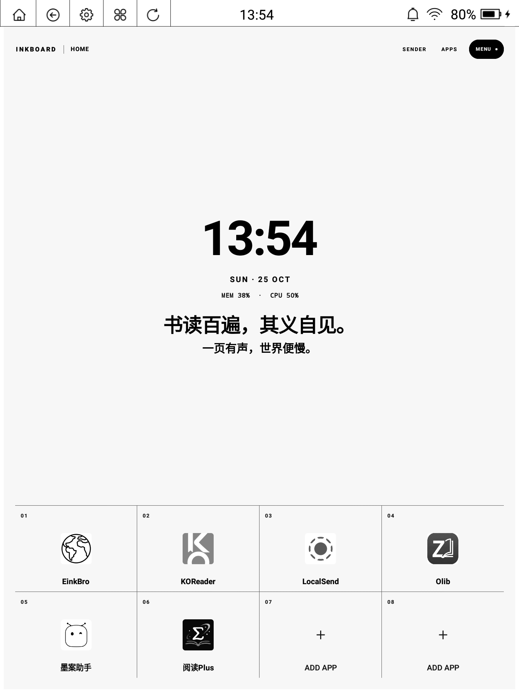
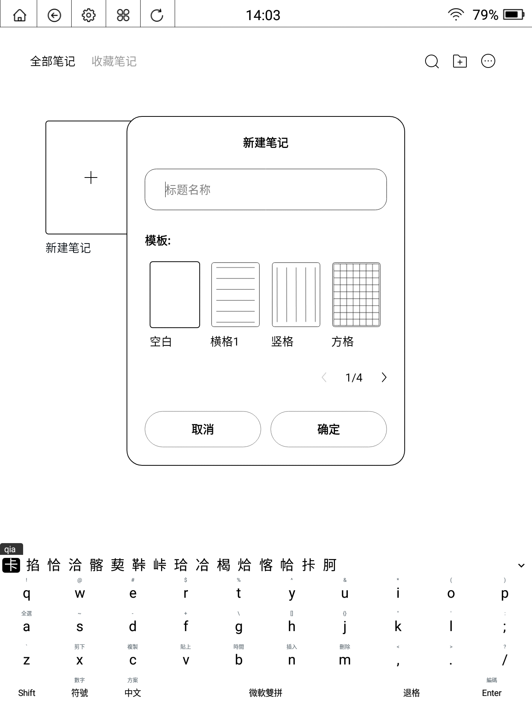

# Android 墨水屏精简与美化（DSH Skill）

一个可直接被 AI 代理调用、也可纯手工执行的方案，用来把一台国产安卓墨水屏设备
整理成「安静、黑白、够用」的状态。

**三件事相互独立，每一步都问过你再动手：**

| 阶段 | 是否必做 | 谁来定 |
|---|---|---|
| ① 精简系统应用 | 总会提供 | **你挑具体禁哪些**（只列系统应用） |
| ② 换墨水屏桌面 | **可选** | **你说装或不装** |
| ③ 换输入法（默认全拼） | **可选** | **你说装或不装** |
| ④ 恢复休眠设置 | 必做 | 不需要问，收尾时必须做 |

全程只用 `adb`：不需要 root、不刷机、不清数据，每一步都可回滚。





## 三条硬规则

1. **只动系统应用。** 精简清单只从 `pm list packages -s` 里出，
   `pm list packages -3`（你自己装的软件）一律不碰——那是你请进门的，不是预装垃圾。
2. **不替你决定。** 禁用哪些包由你勾选；桌面装不装、输入法装不装，都是独立的
   是非题，答"不装"就整段跳过，不会留下半成品状态（不会偷偷禁掉原桌面或原输入法）。
3. **收尾一定关常亮。** 见下面的「电池陷阱」。

## 电池陷阱（务必读）

很多国产墨水屏 ROM 把 Doze 深度休眠关掉了（`mDeepEnabled=false`），
**熄屏是它唯一的省电手段**。如果为了传文件把 `screen_off_timeout` 设成
`2147483647`（永不熄屏），满电静置约一天就会耗光——用户感受是"我没看书它自己就没电了"。

这个坑真实发生过一次。所以：

- 工作期间最多设 `300000`（5 分钟），**绝不设成无穷大**
- 收尾必须执行 `restore-power`，把 `stay_on_while_plugged_in` 归零
- 验证方式：静置超过超时时间后，`dumpsys power` 里必须是 `mWakefulness=Asleep`

## 快速开始

### 1. 准备

打开设备「开发者选项 → USB 调试」，连接数据线，确认：

```bash
adb devices -l          # 状态必须是 device（不是 unauthorized / offline）
```

### 2. 探测与临时保活

```bash
./scripts/eink-adb.sh probe      # 或 Windows: .\scripts\eink-adb.ps1 probe
./scripts/eink-adb.sh persist    # 工作期间保持唤醒，避免传输中断
```

> ⚠️ `persist` 只是临时手段，**收工前必须** `./scripts/eink-adb.sh restore-power`。
> 详见 [SKILL.md 第 1、6 节](SKILL.md)。

### 3. 精简系统应用（你挑）

```bash
./scripts/eink-adb.sh list                       # 导出到 packages-<型号>.txt（仅系统包）
./scripts/eink-adb.sh disable com.moan.appstore com.duokan.einkreader
./scripts/eink-adb.sh enable  com.moan.appstore  # 随时回滚
```

> 建议先把要禁用的包名写进 `disabled-<型号>.txt`，之后
> `enable-file disabled-EPD103.txt` 一条命令还原。
> 分级判断标准见 [`references/package-triage.md`](references/package-triage.md)。

### 4. 换桌面（可选，先问）

不想要就跳过这一整节。想要的话：

```bash
./scripts/eink-adb.sh install InkBoard-v1.0.5.apk
./scripts/eink-adb.sh home ai.openduo.inkboard/.MainActivity
./scripts/eink-adb.sh shot home.png        # 确认新桌面真的在跑
```

确认新桌面正常后，再决定要不要禁用原桌面。桌面横评见
[`references/launchers.md`](references/launchers.md)。

### 5. 换输入法（可选，先问；默认全拼）

不想要就跳过——原输入法保持不动。想要的话：

```bash
# 1) 装 Trime（选对 ABI），设为默认
adb shell ime enable com.osfans.trime/.ime.core.TrimeInputMethodService
adb shell ime set    com.osfans.trime/.ime.core.TrimeInputMethodService

# 2) 首次启动时在向导里选「外部数据目录」→ rime/
RIME=/sdcard/Android/data/com.osfans.trime/files/rime

# 3) 推入全拼排序文件 + 黑白主题
adb push assets/trime/default.custom.yaml  $RIME/
adb push "assets/trime/纯黑白.trime.yaml"  $RIME/

# 4) 键盘样式 → 主题 → 纯黑白；再点「部署」
adb shell am force-stop com.osfans.trime
```

**默认是全拼**（`luna_pinyin_simp`）。只有在明确要求双拼时，才额外推
`assets/trime/optional/double-pinyin/` 里的两个文件，并在 `default.custom.yaml`
里启用 `double_pinyin_mspy`。细节见 [`references/trime.md`](references/trime.md)。

换一个 Trime 版本时，不要手改主题，重新生成：

```bash
python3 scripts/build-trime-bw-theme.py --apk trime.apk --out 纯黑白.trime.yaml
```

### 6. 收尾：恢复休眠 + 体检

```bash
./scripts/eink-adb.sh restore-power     # 必须
./scripts/eink-adb.sh health
```

## 作为 DSH Skill 使用

把整个目录放进技能目录即可被自动发现：

| 作用域 | 路径 |
|---|---|
| 用户级 | `~/.dsh/skills/android-eink-setup/` |
| 项目级 | `<项目根>/.dsh/skills/android-eink-setup/` |
| 兼容 Claude 风格 | `~/.agents/skills/android-eink-setup/` |

```bash
# Windows
xcopy /E /I android-eink-setup "%USERPROFILE%\.dsh\skills\android-eink-setup"
# macOS / Linux
cp -r android-eink-setup ~/.dsh/skills/
```

新开会话后，代理会在技能目录里看到 `android-eink-setup`，并在你提到
「精简这台墨水屏」时自动加载它，然后按「先问再做」的流程跟你确认。

## 仓库结构

```
android-eink-setup/
├── SKILL.md                        # 给 AI 的操作流程（三阶段 + 强制收尾）
├── references/
│   ├── package-triage.md           # 系统包分级清单（只谈系统包）
│   ├── launchers.md                # 桌面横评（可选阶段）
│   └── trime.md                    # Trime 数据目录、全拼/双拼、主题机制
├── scripts/
│   ├── eink-adb.ps1                # Windows 助手
│   ├── eink-adb.sh                 # macOS / Linux 助手
│   └── build-trime-bw-theme.py     # 黑白主题生成器
├── assets/trime/
│   ├── default.custom.yaml         # 默认全拼
│   ├── 纯黑白.trime.yaml            # 黑白主题
│   └── optional/double-pinyin/     # 双拼（默认不装）
└── docs/                           # 截图
```

## 已验证设备

| 设备 | 系统 | 结果 |
|---|---|---|
| 墨案 W7（EPD103，10.3"） | Android 8.1 / API 27 / armeabi-v7a | 24 个系统应用禁用、InkBoard 桌面、Trime + 纯黑白主题，全部正常 |

其它 Allwinner / Rockchip 平台的国产墨水屏（文石、掌阅、汉王、海信、多看）思路一致，
包名不同而已——用 `references/package-triage.md` 的规则去归类，不要照抄包名。

## 风险与边界

- **只做 `pm disable-user` 级别的改动**，不刷机、不 root、不碰系统分区。
- **禁用 OTA 组件后收不到系统更新**，需要时用 `enable` 恢复。
- **禁用输入法前必须先装好替代输入法并验证能打字**；如果选了"不换输入法"，
  原输入法不会被改动。
- **熄屏超时不要设成「永不」**，收尾务必 `restore-power`；已出现耗电时按
  [SKILL.md 第 7 节](SKILL.md)的 `dumpsys batterystats` 命令定位。
- 部分机型（尤其是带手写笔的）在禁用厂商服务后可能丢失笔迹优化，按清单回滚即可。

## 许可

MIT。主题与方案文件可自由修改再分发；InkBoard、Trime 分别遵循其自身许可证。
